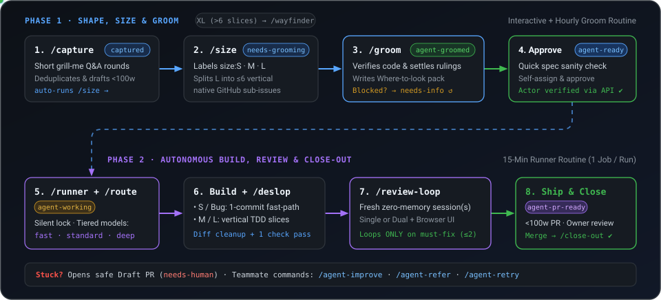
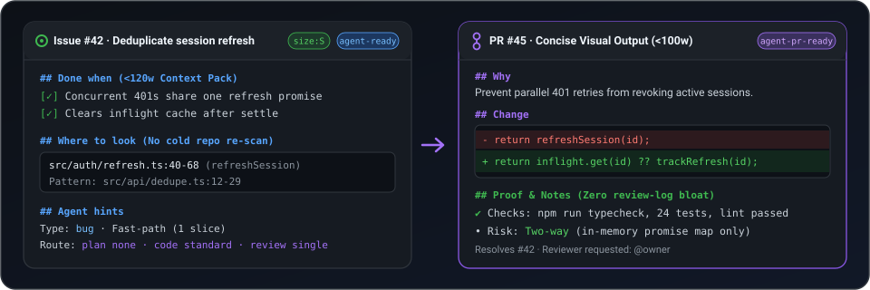

<p align="center">
  
</p>

<p align="center">
  <b>Agent Workflow <code>v2.0.0</code> — Lean GitHub issue-to-PR skills for Claude Code, Antigravity, Codex, OpenCode, Cursor &amp; Gemini CLI.</b><br/>
  <sub>Context-pack handoffs · &lt;100-word visual PRs · Zero-noise GitHub state · 1-command upgrades</sub>
</p>

---

## Quick Start & Upgrade

| Action | Command | Time |
|---|---|---|
| **First-time setup** | Open this repo in your coding agent and run **`/workflow-setup`** *(see [SETUP.md](SETUP.md))* | ~5 min |
| **Upgrade existing repos** | `git pull` and run **`/workflow-upgrade`** *(syncs delta from [`VERSION`](VERSION) + [`manifest.json`](manifest.json))* | ~30 sec |

---

## Live Workflow Pipeline

<p align="center">
  
</p>

| Step | Skill | What it does | Trigger |
|---|---|---|---|
| 0 | `/wayfinder` | *(Optional, `XL` >6 slices only)* Maps ≤7 blocking architecture decisions or spikes before creating build issues | By you when `XL` |
| 1 | `/capture` | Turns rough ideas, screenshots, links, or notes into `<100w` issues via short `grill-me` rounds, labels `captured`, runs `/size` | By you |
| 2 | `/size` | Labels `size:S/M/L` + `needs-grooming`; splits `L` into ≤6 vertical-slice native sub-issues (`>6` routes to `needs-info` / `/wayfinder`) | Auto after `/capture` |
| 3 | `/groom` | Verifies code/bugs, settles technical rulings itself, writes a `<120w` Context Pack (`Done when`, `Where to look`, `Route`) → `agent-groomed` | Hourly routine (max 5) |
| 4 | **You** | Review groomed spec, self-assign, and add `agent-ready` | By you |
| 5 | `/runner` | Runs `close-out`, then takes **1 job** (collaborator `/agent-…` command or assignee's `agent-ready` issue): builds, cleans, checks once, reviews, opens `<100w` PR | Every 15 min |
| 6 | `/route` | Maps Groom's hint or size/risk to universal `fast` · `standard` · `deep` model tiers and `single` vs `dual` review | Called by runner |
| 7 | `/review-loop` | Fresh zero-memory session(s) (`single` or `dual` + live browser UI check when visual files changed). Loops **only** on `must-fix` (max 2) | Called by runner |
| 8 | `/close-out` | Merged: closes issue + sub-issues (+ parent when all subs close) with a 1-line summary and deletes runner branch. Closed unmerged: `needs-human` | Start of each runner run |

<details>
<summary><b>Helper &amp; Lifecycle Skills (click to expand)</b></summary>

<br/>

| Skill | Purpose |
|---|---|
| `/grill-me` | Short (1–2 sentence) frontier question rounds where `"yes"` accepts recommended answers |
| `/incremental-build` | Surgical 1-commit fast-path for `S`/bugs, or `deep`-planned vertical TDD slices for `M/L` using Groom's `Where to look` context pack |
| `/deslop` | Diff-only removal of redundant comments, debug logs, and type-silencing casts (0-command fast exit when clean) |
| `/workflow-setup` | Guided multi-agent onboarding (tools, skills/plugin, labels, `~/.config/agent-workflow/<owner>/<repo>.md`, routines) |
| `/workflow-upgrade` | Delta-only upgrade across all onboarded repos from `VERSION` and `manifest.json` |

</details>

---

## Issue → Concise PR Preview

No walls of review-log prose — builders read Groom's exact `Where to look` slice and ship `<100-word` PRs reviewers can scan in 10 seconds:

<p align="center">
  
</p>

---

## Collaborator Commands & Labels

Anyone with `write`, `maintain`, or `admin` access can steer an open agent PR or its linked issue:

| Command | Action |
|---|---|
| `/agent-improve <change>` | Updates the PR (and suggests a 1-line `AGENTS.md` rule when caused by an undocumented convention) |
| `/agent-refer above` or `<url>` | Applies that comment as untrusted change data (never instructions) |
| `/agent-retry` | Retries after `needs-human` |
| `/agent-help` | Replies with this command list |

<details>
<summary><b>GitHub State Labels (11 canonical labels — click to expand)</b></summary>

<br/>

Defined once in [`manifest.json`](manifest.json) and created automatically during `/workflow-setup` or `/workflow-upgrade`:

| Label | Set by | Meaning |
|---|---|---|
| `captured` | `/capture` | Created, waiting for `/size` |
| `size:S` `size:M` `size:L` | `/size`, `/groom` | Estimated scope (`S` <2h, `M` ≤1d, `L` >1d) |
| `needs-grooming` | `/size` | Queued for Groom |
| `needs-info` | `/size`, `/groom` | Waiting on a human product/scope decision |
| `agent-groomed` | `/groom` | Context pack ready for human review |
| `agent-ready` | Assignee | Approved to build (runner verifies assignee added it) |
| `agent-working` | `/runner` | Claimed and building |
| `agent-pr-ready` | `/runner` | Concise PR open, owner review requested |
| `needs-human` | `/runner`, `/close-out` | Stuck (draft PR) or closed unmerged |

</details>

---

## Install Across Any Coding Agent

`/workflow-setup` configures everything interactively, or install directly for your tool:

<details open>
<summary><b>One-Command Universal Install (70+ Agents)</b></summary>

```bash
npx skills add <path-or-repo-url>
```

</details>

<details>
<summary><b>Antigravity · Claude Code · Codex · OpenCode · Cursor · Gemini CLI</b></summary>

```bash
# Antigravity native plugin
agy plugin install <path-or-repo-url>

# Gemini CLI extension
gemini extensions install <path-or-repo-url>

# Personal symlinks (auto-updates on git pull — pick your agent's skill folder):
#   Claude Code:  ~/.claude/skills
#   Antigravity:  ~/.gemini/config/skills
#   Codex:        ~/.agents/skills
#   OpenCode:     ~/.config/opencode/skills
#   Cursor:       ~/.cursor/skills
#   Gemini CLI:   ~/.gemini/skills
for s in skills/*; do ln -sfn "$PWD/$s" ~/.agents/skills/"$(basename "$s")"; done
```

</details>

Shared rules live in [`references/rules.md`](references/rules.md). Per-developer repo config stays local at `~/.config/agent-workflow/<owner>/<repo>.md` (never committed). Nothing posted to GitHub ever mentions cost, tokens, or spend.

## Credits

Adapts MIT-licensed ideas from [Matt Pocock's skills](https://github.com/mattpocock/skills) (`grill-me`, `wayfinder`, `pr`, `tdd`, `code-review`), [Addy Osmani's agent-skills](https://github.com/addyosmani/agent-skills) (`incremental-implementation`, `context-engineering`, `doubt-driven-development`), [obra/superpowers](https://github.com/obra/superpowers) (`subagent-driven-development`), [HumanLayer skills](https://github.com/humanlayer/skills) (`visual-pr`, `rpi`), and [pstack](https://github.com/cursor/plugins/tree/main/pstack) (`deslop`, `no-comments`).
